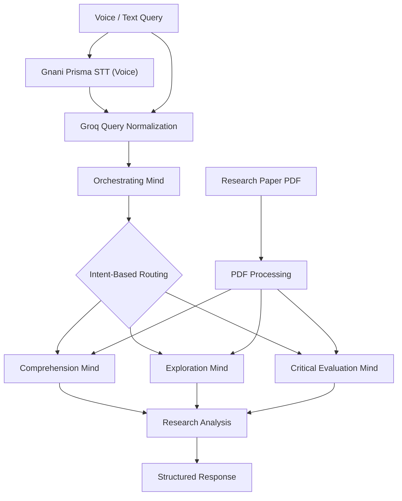

# 📄 PaperAudit AI
### Dynamic, Intent-Aware Research Paper Orchestrator

> An adaptive research paper analysis system powered by CrewAI, Groq, and Gnani Prisma Speech-to-Text.

## 💡 The Problem

Research papers are often difficult to understand, analyse, and evaluate. Different readers have different needs:

- 🎓 **Learners:** Understand complex concepts and methodologies.
- 🔬 **Researchers:** Discover research gaps and future directions.
- 📝 **Peer Reviewers:** Evaluate experimental results, baselines, and limitations.

Traditional document chatbots often follow similar workflows regardless of what the user actually wants to know. Additionally, typing lengthy technical questions creates unnecessary interaction friction.

## 🚀 Our Solution

**PaperAudit AI** introduces a dynamic, intent-aware multi-agent architecture that selects the most relevant analytical specialist according to the user's query.

### Key Features

- 🎙️ **Voice & Text Interaction:** Ask questions naturally using Gnani Prisma STT or text, including English and Hinglish.
- 🧠 **Query Normalization:** Groq refines and structures user queries while preserving their original intent.
- 🔀 **Dynamic Agent Selection:** An Orchestrating Mind identifies the user's intention and selects the appropriate specialist instead of executing every agent for every question.
- 📚 **Grounded Analysis:** Specialists use PDFSearchTool to retrieve relevant information from uploaded research papers.

## 🏗️ System Architecture

### 🧠 Three Specialised Analytical Minds

| Agent | Responsibility |
|---|---|
| **Comprehension Mind** | Explains concepts, mathematics, and methodologies. |
| **Exploration Mind** | Identifies research gaps, assumptions, and future directions. |
| **Critical Evaluation Mind** | Evaluates experiments, baselines, metrics, and limitations. |

**Dynamic routing example:**

- "Explain this methodology" → Comprehension Mind.
- "What research gaps exist?" → Exploration Mind.
- "Are these experimental results convincing?" → Critical Evaluation Mind.

**Same paper. Different questions. Different specialists.**

## 🛠️ Technology Stack

**Python** · **CrewAI** · **Groq** · **Gnani Prisma STT** · **PDFSearchTool** ·  · **ChromaDB** · **Streamlit**

## ⭐ Core Innovation

Unlike a fixed multi-agent workflow, PaperAudit AI dynamically selects its analytical specialist based on the user's intent, making research-paper interaction more focused and adaptive.

**Our goal: Make scientific research easier to understand, explore, and evaluate.**